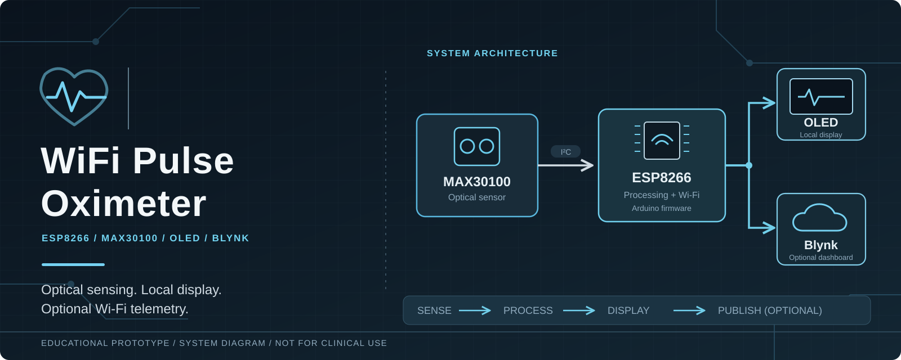

# Wi-Fi Pulse Oximeter

**ESP8266 · MAX30100 · OLED · Blynk IoT**

An educational IoT prototype that reads heart-rate and estimated peripheral oxygen saturation (SpO₂) from a MAX30100 module. The ESP8266 displays values on an I²C OLED and can publish valid readings to a Blynk dashboard over Wi-Fi.

**Status:** Tutorial-derived repository refreshed with a cleaner Arduino sketch and local configuration. The revised firmware has **not yet been verified on physical hardware**. The project is neither a commercial product nor a certified medical instrument.

> **Safety:** Readings from this prototype must not be used to diagnose, monitor, or make treatment decisions about a medical condition. Poor sensor contact, motion, ambient light, circulation, and other factors can affect pulse-oximeter readings. Use an appropriately validated device and professional medical advice for health decisions.

## Hardware and data path

The banner above shows the proposed sensing and communication path. It is an architectural illustration, not evidence of assembled hardware or calibrated readings.

| Component | Role |
| --- | --- |
| ESP8266 / NodeMCU | I²C acquisition, local display updates, Wi-Fi communication |
| MAX30100 breakout | Optical sensor used to estimate pulse rate and SpO₂ |
| I²C OLED compatible with OakOLED | On-device readout |
| Blynk IoT | Optional remote dashboard; requires your own account and device token |

**I²C wiring described by the sketch:** NodeMCU `D1` / GPIO5 → SCL, `D2` / GPIO4 → SDA; connect GND across all modules. Verify the particular breakout board's voltage, regulator, and pull-up specifications before wiring power. The MAX30100 and OLED share the I²C bus. No interrupt pin is used by this sketch.

The existing [circuit image](Circuit%20Diagram%20.jpeg) is retained for reference; its creator and reuse permissions have not been verified. Treat the sketch pin assignments and the hardware datasheets as authoritative until the diagram is reviewed.

## Firmware setup

The maintained Arduino sketch is at [`firmware/PulseOximeter/PulseOximeter.ino`](firmware/PulseOximeter/PulseOximeter.ino). The old extensionless tutorial file was removed from the current tree.

1. Install [Arduino IDE](https://www.arduino.cc/en/software) and the [ESP8266 Arduino board package](https://github.com/esp8266/Arduino).
2. Install the [MAX30100 Arduino library](https://github.com/oxullo/Arduino-MAX30100), Blynk library, and compatible OakOLED library. Use library versions compatible with your ESP8266 core; a reproducible version matrix has not yet been validated.
3. Copy `firmware/PulseOximeter/secrets.example.h` to `firmware/PulseOximeter/secrets.h`. Enter a **new** Blynk device token, Blynk template ID, Wi-Fi name, and Wi-Fi password.
4. In Blynk, configure data streams `V7` for heart rate (BPM) and `V8` for SpO₂ (%). This is **Blynk cloud integration**, not a self-hosted web dashboard.
5. Open the `.ino` in Arduino IDE, choose your exact ESP8266 board and port, compile, and upload. Open Serial Monitor at **115200 baud**.

The firmware attempts to keep local sampling active when Blynk is disconnected. Cloud telemetry is sent only when the sketch reports a nonempty sensor reading and a Blynk connection is available. This behavior still requires testing on a real device and network.

## Verification status

| Item | Current evidence |
| --- | --- |
| Firmware source and dependencies | Present in this repository |
| Local OLED and MAX30100 acquisition | Implemented in code; hardware retest required |
| Blynk cloud output | Implemented with `V7` and `V8`; account and hardware test required |
| Sensor accuracy | No calibration or clinical validation provided |
| Reliability during Wi-Fi loss | Periodic, time-limited reconnect attempts; not yet measured |
| Medical-device certification | Not claimed |

## Security and source attribution

The earlier public firmware contained hardcoded network/device credentials. They have been removed from the current tree, but **older Git commits still contain them**. Rotate any real credentials and device tokens before using the repository. Read [SECURITY.md](SECURITY.md).

The original code and README closely followed the published [How To Electronics MAX30100/ESP8266 tutorial](https://how2electronics.com/MAX30100-PULSE-OXIMETER-WITH-ESP8266/). The new sketch is a maintenance rewrite, not a claim that the original circuit or approach was invented here. Full details are in [docs/PROVENANCE.md](docs/PROVENANCE.md).

## Maintainer and licensing

Maintained by **Sai Tanveesh** — [GitHub](https://github.com/Saitanveesh) · [LinkedIn](https://www.linkedin.com/in/sai-tanveesh-028881215/).

The repository is publicly visible but has **no blanket open-source license**. Original contributions and third-party materials have different rights. See [LICENSE](LICENSE) and [provenance](docs/PROVENANCE.md) before reuse or redistribution.
